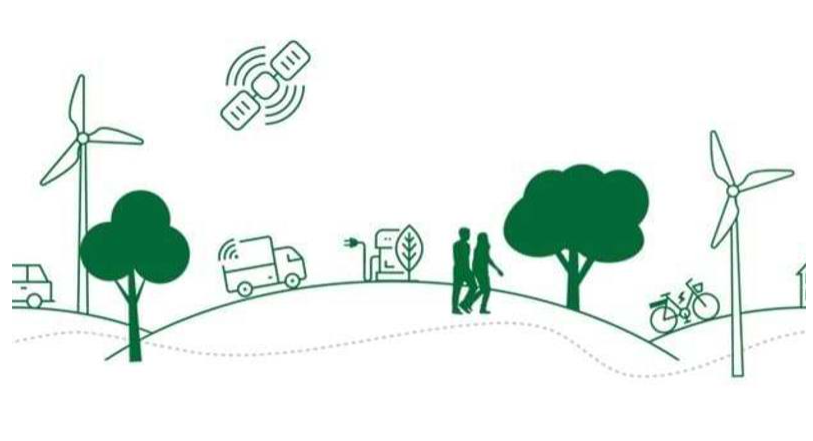

# Baggrund
Det nuværende produkt tog afsæt i det succesfulde AI-signaturprojekt “Intelligent flådestyring og klimasmarte kørselsmønstre”, hvor fem kommuner i en brugerdrevet udviklingsproces skabte den innovative AI-løsning: FleetOptimiser.

AI-signaturprojektet har vist, at det kan lade sig gøre at sætte fart på den grønne omstilling af transportområdet på en intelligent måde, hvor der på samme tid spares penge og CO2 - og uden at myndighedernes kerneopgave sættes over styr.

Derfor er det nuværende produkts ambition at skalere løsningskonceptet og at få tempo ind i arbejdet med at høste gevinsterne.

Opskaleringen er blevet mulig med støtte fra Digitaliseringsstyrelsens tilskudspulje for nye teknologier.
