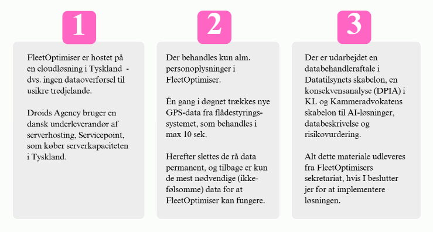

# Forberedelse til teknisk implementering
Der er et par ting, som I allerede nu kan sætte gang i, som bringer jer tættere på at kunne implementere FleetOptimiser. Blandt andet har FleetOptimiser brug for data fra det system, som indsamler GPS-data fra jeres køretøjer, f.eks. jeres flådestyringssystem. Derfor skal der laves en integration via flådestyringssystemets API, hvorfra data kan trækkes ud. Nedenfor finder I en oversigt over de ting der er brug for, og som I kan sætte i gang nu, for at blive klar til den tekniske implementering.
 
 

## To-do: Fremskaf dokumentation på API fra flådestyringsleverandør*
Droids Agency, der udvikler og drifter FleetOptimiser, har brug for at vide, hvordan jeres flådestyringssystems API er bygget op, og hvilke oplysninger/felter FleetOptimiser skal spørge efter når der skal trækkes data. De har brug for dokumentation på API for at kunne lave en god og stabil integration mellem FleetOptimiser og jeres flådestyringssystem
*Bruger I Mileage Book, Fleet Complete, Skyhost eller Clevertrack som leverandør, behøver I ikke at fremskaffe dokumentation, da FleetOptimiser allerede har integrationer til disse flådestyringssystemer.
 
 

## To do: Fremskaf API-nøgle til kontoen/de konti hvorfra der skal trækkes data
API-nøglen kan ofte findes i flådestyringssystemet under indstillinger for kontoen. Ellers kan jeres flådestyringsleverandør helt sikkert hjælpe med at generere en API-nøgle til jer.
Eksempel på hvordan en API-nøgle kan se ud: gWCqezwlerkMIfu5hItQJ2Sg/Wc5Sk1tzltChi4kaHQdqNu1
 
 

## To do: Kontakt jeres interne GDPR-ansvarlige
Det er en god idé at kontakte jeres informationssikkerheds-/GDPR-ansvarlige allerede nu og orientere om den igangværende proces med anskaffelsen af FleetOptimiser. På den måde er de klar til at hjælpe jer med at få indgået en databehandleraftale, når I kommer dertil.
Vi har herunder samlet de vigtigste pointer til den indledende dialog med jeres GDPR-ansvarlige:
 
 

