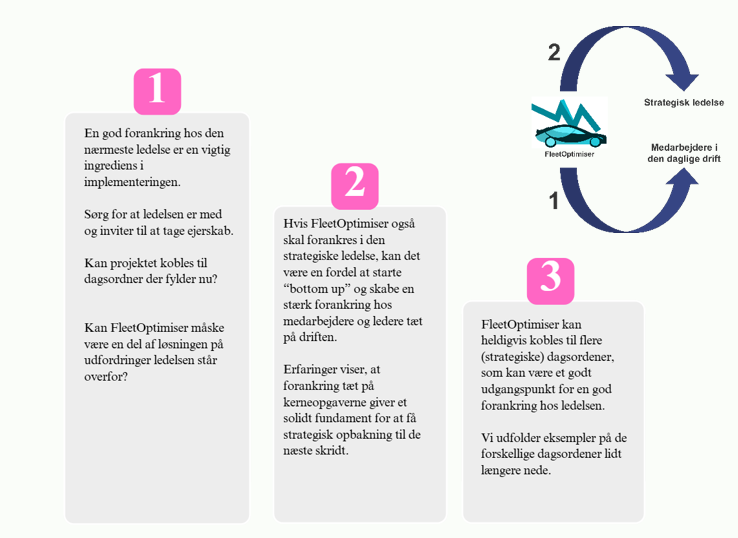

# Organiseringsanbefalinger

Skaleringsprojektets myndigheder udgør en guldgrube af gode erfaringer med at organisere og forankre FleetOptimiser.
Nogle har båret FleetOptimiser ind via digitaliseringsafdelingen, andre direkte ind i den daglige drift af køretøjsflåden. Og begge veje er gode!
Vi har dog alligevel et par gode råd, som I kan tage med i jeres overvejelser, når I selv skal i gang med at etablere en projektorganisation omkring FleetOptimiser.
 

## Anbefaling: Start med ét fagområde/forvaltning

Alle myndigheder i skaleringsprojektet er startet med at kigge på og bruge FleetOptimiser på en
afgrænset del af bilflåden, for eksempel hjemmeplejens biler eller puljebiler ved
administrationsbygninger. Det er typisk også her, at køretøjsflåden er godt organiseret. Vi anbefaler,
hvis muligt, at I tager fat et sted, hvor ovenstående er opfyldt. Selv med en mindre pulje af biler, er
der gode erfaringer at hente, og I kan let justere på projektet i opstarten, når det kun er relativt få
biler det drejer sig om.
 

## Anbefaling: Giv projektet ro og tid til at opbygge tillid i organisationen: Lyt, lær og justér – og få et godt afsæt til næste skridt

Selvom FleetOptimiser har flere år på bagen, kan det stadig være relativt nyt land for organisationen
at arbejde med flådestyring, og ikke mindst kunstig intelligens, selvom det i stor stil skyller ind over
os i disse år.

Det kan derfor godt kræve lidt tålmodighed og tid at få skabt det rette fundament for
FleetOptimiser, hvor der er tillid til løsningen og vi kan stole på simuleringerne - og det er helt
okay. Det gør nemlig at det bliver både lettere og hurtigere at tage de næste skridt hvis I vil udvide
til flere fagområder senere, at I da kan relatere til erfaringerne fra andre dele af organisationen.
 

## Anbefaling: Etablér et netværk på tværs af myndigheder og brug hinanden som sparringspartnere

Der er bred enighed blandt dem, som har implementeret FleetOptimiser og dem der er tæt på, om at
det har stor værdi at have et netværk på tværs af myndigheder, som man løbende kan udveksle
erfaringer og sparre med.

Vi anbefaler derfor at deltage i FleetOptimiser-netværket. Vi foreslår, at mødes indimellem i 30-45
minutter til en gang “bordet rundt” og evt. skiftes til at lave en kort casepræsentation, efterfulgt af
diskussion/sparring med udgangspunkt i egen proces.

Som en projektdeltager sagde i forbindelse med en workshop: "Vi kan låne tillid af hinanden" når vi
går sammen i et fælles projekt og har et netværk vi kan læne os op ad. Vi synes det rammer spot on!
 

## Anbefaling: Inviter kollega(er) fra fagområdet med i projektet så tidligt som muligt – og få en vigtig ambassadør!

Starter I med hjemmeplejen eller et andet fagområde? Så vil vi klart anbefale jer at få en kollega fra
fagområdet/forvaltningen med i projektgruppen. De kan nemlig blive vigtige ambassadører der
hjælper med at bygge bro, adressere og minimere kompleksitet og være "oversætter" der kan
formidle både muligheder og bekymringer mellem fagområdets personale og projektgruppen.
 

## Opmærksomhed: Er der et godt ledelsesophæng i jeres organisation?

