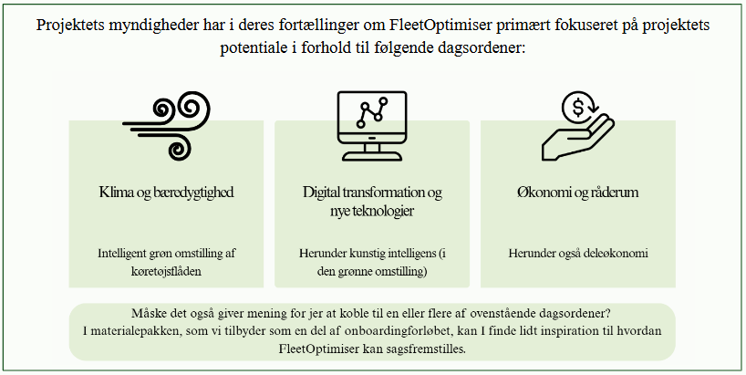

# Økonomi og beslutning

Hvordan ser økonomien ud?

Det spørgsmål har vi selv fået mange gange, og I vil formentlig
også blive spurgt om det undervejs i forberedelserne. Generelt
er det sådan, at jo flere køretøjer, jo billigere bliver det pr.
køretøj. For de penge kan I lave alle de simuleringer I vil hver
eneste dag, og hele tiden have adgang til den nyeste version af
værktøjet.

Nedenfor har vi samlet et par tips til, hvordan I kan fremstille
økonomien samt et par råd til, hvordan I kan sagsfremstille
implementeringen af FleetOptimiser, baseret på hvad projektets
myndigheder har gjort.
 

## Anbefaling: Lav en business case med egne tal
Vi har lavet en simpel skabelon til en business case, som I kan
bruge i jeres videre arbejde. Den indeholder udgifterne til drift
af et flådestyringssystem samt FleetOptimiser, holdt op imod
hvad en bil ca. koster pr. år i faste og driftsomkostninger og
regner selv ud hvor mange biler I skal udfase for at få break-
even på omkostningerne til et flådestyringssystem og
FleetOptimiser.

Og der er faktisk flere gevinster både ved et
flådestyringssystem alene og FleetOptimiser end der opgjort i
skabelonen.

Find skabelonen her: https://boks.os2.eu/s/Hgtpa9e8nbSe73z 
 

## Anbefaling: Når I skal i gang med sagsfremstilling og kommunikation om projektet
Lav en tydelig rammesætning omkring projektet når I går i gang. Hvad vil I gerne opnå med
implementeringen af FleetOptimiser? Hvilken historie er det I gerne vil fortælle om projektet og
ambitionerne bag, både på den korte og den lange bane?
 

 

## Anbefaling: Klima og bæredygtighed er et godt afsæt for implementeringen
Vi vil klart anbefale at bruge klima og bæredygtighedsdagsordenen som afsæt for implementering
af FleetOptimiser. Det budskab er der langt flere der køber ind på end at det handler om besparelser.
Det kan dog godt ligge som en bagvedliggende ambition, f.eks. i form af at I gerne vil lave den
grønne omstilling så økonomisk fornuftig som muligt. Det kunne være at I gerne vil optimere,
samtidig med at I laver den grønne omstilling, ved at udfase eventuelt identificeret overkapacitet
eller lignende.
 

## Anbefaling: Italesæt FleetOptimiser som dialogværktøj
Da Esbjerg Kommune gik i gang med FleetOptimiser var de meget klare omkring at værktøjet
skulle understøtte dialog. Den pointe er der flere af os der sidenhen har taget til os. Mange
digitaliseringsprojekter handler typisk om effektivisering og administrative besparelser, og der er
ingen tvivl om at FleetOptimiser også falder ned i den kategori. Men vi oplever en bedre respons
når vi italesætter FleetOptimiser som dialogværktøj. Og langt de fleste er faktisk glade for det, som
værktøjet bidrager med i dialogen om hvilke muligheder der kunne være for at nedbringe CO2-
udledningen og lave den smarteste omstilling af køretøjerne til grønnere alternativer.
