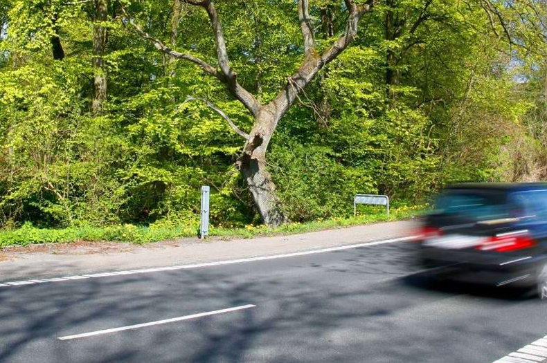

# Faser i projektet
Her får du et overblik over hvordan vi arbejdede med faserne i projektet.

## Projektfaser - overblik
1. Opstart, etablering af agil arbejdsform og organisering i projektet
2. Forberede flådestyringsløsninger, GPS’er og datagrundlag i kommunerne
3. Integration af flådestyringsløsninger med FleetOptimiser og konfiguration i myndigheder
4. Træning og organisatorisk implementering af processer og styringsmodel
5. Drift og løbende tilpasninger af flåden
6. Afrapportering og plan for udbredelse af løsning og erfaringer nationalt

Herudover igangsatte vi et gennemgående spor med fokus på transformationsledelse.

## Fase 1: 
### Opstart, etablering af agil arbejdsform og organisering i projektet
Erfaringerne fra tidligere AI-projekter viser, at det er afgørende for et succesfuldt forløb, at der tidligt skabes et fælles samarbejdsgrundlag med forventningsafstemning mellem partnerne.

En af nøglerne til FleetOptimisers succes var den agile arbejdsform, som var gennemgående for det gennemførte AI-signaturprojekt. Nye deltagere i projektet skulle derfor on-boardes og introduceres til løsningen og den agile arbejdsform.

Vi startede forløbet med et fælles kick-off, hvor en agil coach introducerede til arbejdsformen, og hvor vi fik fastlagt roller og formater (afviklet den 16/3-2023). Herudover konstituerede de forskellige styringsorganer i projektet, så organiseringen var på plads fra start.

## Fase 2: 
### Forberede flådestyringsløsninger, GPS’er og datagrundlag i kommunerne
I denne fase skulle der etableres et datagrundlag baseret på de faktiske kørselsmønstre.

Flere af projektparterne havde allerede arbejdet ihærdigt på at etablere flådestyring og på indsamling af data. Nye deltagere, som ikke havde dette grundlag på plads, skulle have etableret en understøttende infrastruktur, inden de kunne arbejde struktureret med intelligent omstilling og tilpasning af flåden.

Deltagerne blev opdelt efter modenhedsniveau for at sikre, at denne øvelse blev gennemført med særlig støtte til de parter, som havde størst brug for hjælp til at komme i gang med flådestyring. Deltagerne blev assisteret igennem en proces, hvor data vedrørende køretøjer, økonomi, udledning mv. blev kvalitetssikret. 
Processen var baseret på erfaringerne med kvalitetssikring fra AI-signaturprojektet og er samlet i en drejebog, som strømliner arbejdet. Der blev i denne forbindelse også etableret en baseline for CO2-udledning og omkostninger med tilhørende business cases pr. deltager i projektet.

## Fase 3: 
### Integration af flådestyringsløsninger med FleetOptimiser og konfiguration i myndigheder
I takt med at deltagermyndighederne fik datagrundlaget på plads blev der etableret integrationer mellem FleetOptimiser og myndighedernes flådestyringsløsninger.

Når myndighederne er tilsluttet, skal løsningen konfigureres til lokale forhold og behov.

## Fase 4: 
### Træning og organisatorisk implementering af processer og styringsmodel
I fase 4 af projektet handlede det om at få Fleet Managers og øvrige brugere af løsningen til at blive fortrolige med løsningen som afsæt for en organisatorisk implementering af de processer og beslutningsstrukturer, som skulle etableres i myndighederne. Det handlede om at få omsat simuleringsresultater fra FleetOptimiser til konkrete handlinger.

Erfaringerne var indtil videre, at en realisering af værktøjets potentiale i høj grad handlede om at skabe tillid til løsningen. FleetOptimiser udfordrer den måde, vi plejer at gøre tingene på og den decentrale styringsmodel, der ofte er implementeret i offentlige myndigheder. 
Derfor skal der sideløbende med ibrugtagning af værktøjet sikres en ny datadrevet styringsmodel, hvor beslutninger om flådeplacering, køretøjstyper, kapacitet, tildeling af ture og transportmidler mv. i højere grad træffes ud fra konkrete data og simuleringer. Fasen handler derfor primært om datadrevet ledelse og transformation.

## Fase 5:
### Drift og løbende tilpasninger af flåden
Når løsningen var i drift hos de enkelte myndigheder, og der blev implementeret relevante styringsprocesser, startede transformationen ved udskiftning af køretøjer, tilpasning af kapaciteten og ændring i kørselsadfærden.

I en kommune som Aarhus var de dengang ca. 750 registrerede køretøjer fordelt på ca. 185 lokationer. Knap 75 procent af disse var fossile køretøjer (560 i faktiske tal). Omtrent 45 procent af den samlede bilflåde var leaset, hvilket betød, at der var bindingsperioder på køretøjerne og begrænsninger på, hvor mange kilometer man måtte køre i de enkelte køretøjer. Samtidig var der behov for at udskifte fossilkøretøjer, så man løbende kunne nå at tilpasse antallet af ladestandere og ladekapaciteten på de enkelte lokationer.

Det var dette daglige puslespil, de lokale Fleet Managers skulle få til at gå op på den mest optimale måde, således at der var den tilstrækkelige kapacitet til rådighed for at kunne udføre de offentlige kerneopgaver.

## Fase 6: 
### Afrapportering og plan for udbredelse af løsning og erfaringer nationalt
Som afslutning på projektet blev der udarbejdet en slutrapportering til Digitaliseringsstyrelsen og projektets parter. Vi lagde kræfter i udbredelse af viden om projektets erfaringer på diverse platforme, herunder projektets egen hjemmeside, sociale medier, gå-hjem-møder og konferencer.

I lighed med konceptet for afslutning af AI-signaturprojektet inviterede vi alle interesserede til et Grand Review på projektet i minikonference-format. Det var en stor succes, og det blev afholdt sommeren 2022 på Maltfabrikken i Ebeltoft.

Herudover ville projektet komme med forslag til en videre skalering af løsningen til nationalt plan i samarbejde med KL, Digitaliseringsstyrelsen og andre kræfter, som kunne påvirke den nationale strategi for bæredygtig transport i det offentlige.

## Tværgående spor om transformationsledelse og følgeforskning
Erfaringen fra Aarhus Kommune og andre myndigheder var, at det var svært at transformere digitalt. Topledelsen i Aarhus Kommune var meget optagede af udfordringen med skalering af digitale løsninger, herunder øget brug af data og digitale løsninger på klimaområdet, hvor vi arbejdede med begrebet "vilde problemer".

For at sikre maksimalt fokus på transformation, skalering og læring undervejs i projektet havde ledelsen i Aarhus Kommune bevilliget en virksomheds-ph.d. til at bidrage til metodeudvikling og følgeforskning i projektet.

