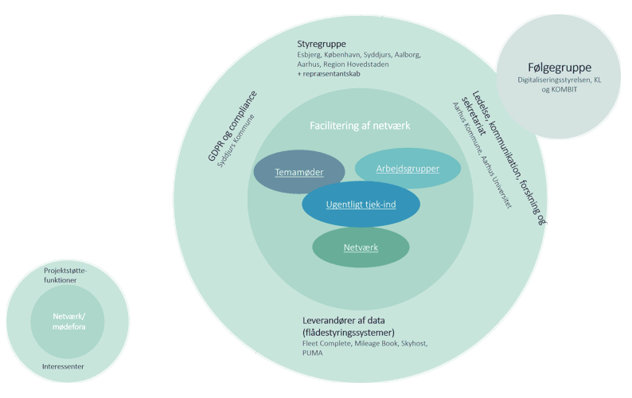
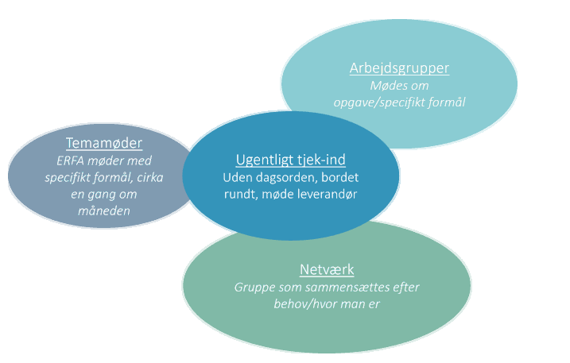

# Projektorganisationen
Her kan du læse om interessefællesskaberne, og hvordan de forskellige projektstøttefunktioner bidrog til projektets mål.

AI-projektet FleetOptimiser blev organiseret ud fra et dynamisk og netværksbaseret perspektiv og var inspireret af agile metoder.

Der var i arbejdsformen et stort fokus på, at projektet skulle understøtte myndigheder og projektdeltagere, der hvor de var, og at der var meningsfulde fora for alle involverede i projektet. Organiseringen var således ikke statisk, men blev udviklet løbende. 

## Facilitering af netværk
Projektets kerne mødtes og samarbejdede løbende i forskellige fora:

Formålet med de forskellige aktiviteter var først og fremmest at understøtte sparring og erfaringsudveksling på tværs af de deltagende myndigheder om alt fra flådestyring, forankring og implementering af FleetOptimiser til økonomi, klima og bæredygtighedstiltag. 
Derudover understøttede organiseringen også videreudviklingen af FleetOptimiser og løbende, fælles opgaver.

## Projektstøttefunktioner

Projektets kerne blev understøttet af en række støttefunktioner, som blandt andet bidrog med data, kommunikation, informationssikkerhed og tilpasning af FleetOptimiser-værktøjet.

Støttefunktionernes rolle er uddybet nedenfor.

<strong>Styregruppe</strong>

<strong>Opgave</strong>

Styregruppen havde blandt andet til opgave at understøtte projektgruppen med forankring, implementering og skalering af FleetOptimiser. Herudover skulle styregruppen hjælpe med at realisere projektets overordnede målsætning om at accelerere den grønne omstilling af transporten ved at skabe en CO2-neutral flåde ud fra nøgleprincippet om optimering samtidig med omstilling.

<strong>Sammensætning</strong>

Styregruppen blev sammensat ud fra et ønske om at sikre repræsentation af større og mindre myndigheder – både fra digitaliseringsområdet såvel som fagforvaltninger. Herudover blev der taget højde for repræsentation af myndigheder, der allerede havde implementeret FleetOptimiser samt myndigheder, der skulle i gang med at etablere det tekniske og organisatoriske grundlag for implementeringen.

<strong>Mødefrekvens</strong>

Styregruppen mødtes 6-8 gange om året eller efter behov, hvis der var beslutninger, som krævede tættere og hyppigere drøftelser.

<strong>Ledelse, kommunikation, forskning og sekretariat</strong>

<strong>Opgave</strong>

Projektets stabsfunktion blev forankret i Aarhus Kommune og varetog opgaver inden for blandt andet kommunikation, koordinering og generel projektunderstøttelse.

<strong>Forskning</strong>

Projektets følgeforskning blev forankret i et samarbejde mellem Aarhus Kommune og Aarhus Universitet i form af blandt andet en virksomheds-ph.d. Der blev forsket i digital forestillingsevne, ledelse af digital transformation samt skalering og spredning.

<strong>Sekretariat</strong>

Sekretariatsbetjeningen af styregruppen blev også forankret i Aarhus Kommune.

<strong>Produkt- og udviklingsteam</strong>

<strong>Opgave</strong>

Her samarbejdede projektets myndigheder med projektets primære leverandør, Droids Agency, om tilpasning af FleetOptimiser, så værktøjet afspejlede myndighedernes ønsker og behov.

<strong>Sammensætning</strong>

Tilpasning af FleetOptimiser skete i et tæt og brugerdrevet samarbejde med leverandøren. Produkt- og udviklingsteamet blev løbende udvidet, efterhånden som flere myndigheder blev klar til at tage FleetOptimiser i brug. Det var valgfrit, om og hvor ofte man ønskede at deltage i dette team.

<strong>Mødefrekvens</strong>

Produkt- og udviklingsteamet mødtes ugentligt til et 20-minutters tjek-ind-møde. En gang om måneden mødtes de til et udviklingsprioriteringsmøde, hvor udviklingsforslag blev gennemgået og diskuteret. Endelig mødtes teamet, når der var behov for en præsentation af nye funktioner.

<strong>Leverandør af data</strong>

GPS-data til FleetOptimiser blev leveret via myndighedernes flådestyringssystemer, som udstiller data via API.

Leverandørerne af flådestyringssystemer var dermed vigtige interessenter i projektet.

<strong>GDPR og Compliance</strong>

Syddjurs Kommune blev tovholder på informationssikkerheden i FleetOptimiser.

Syddjurs Kommune havde stor erfaring med ledelse af AI-signaturprojekter og var tidligere projektejer på FleetOptimiser. Derfor havde de også vigtig viden og erfaringer, som projektet trak på i forbindelse med udarbejdelse af databehandleraftale, risikovurdering og konsekvensanalyse for løsningen.

<strong>Følgegruppe</strong>

<strong>Sammensætning</strong>

Projektet havde tilknyttet en følgegruppe med repræsentanter fra Digitaliseringsstyrelsen (som havde bevilliget midlerne til projektet) samt Kommunernes Landsforening (KL) og KOMBIT.

<strong>Opgave og mødefrekvens</strong>

Følgegruppen og projektets stabsfunktion fra Aarhus Kommune mødtes en gang i kvartalet til en status samt sparring på retning og læring fra projektet.

